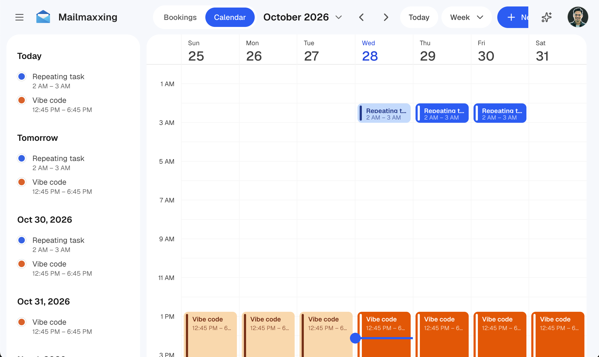
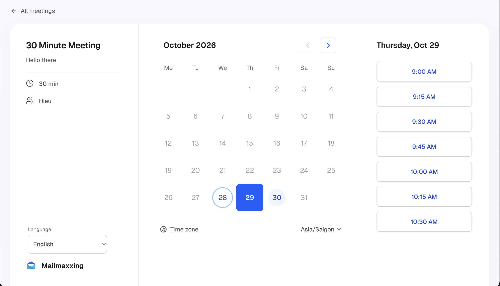
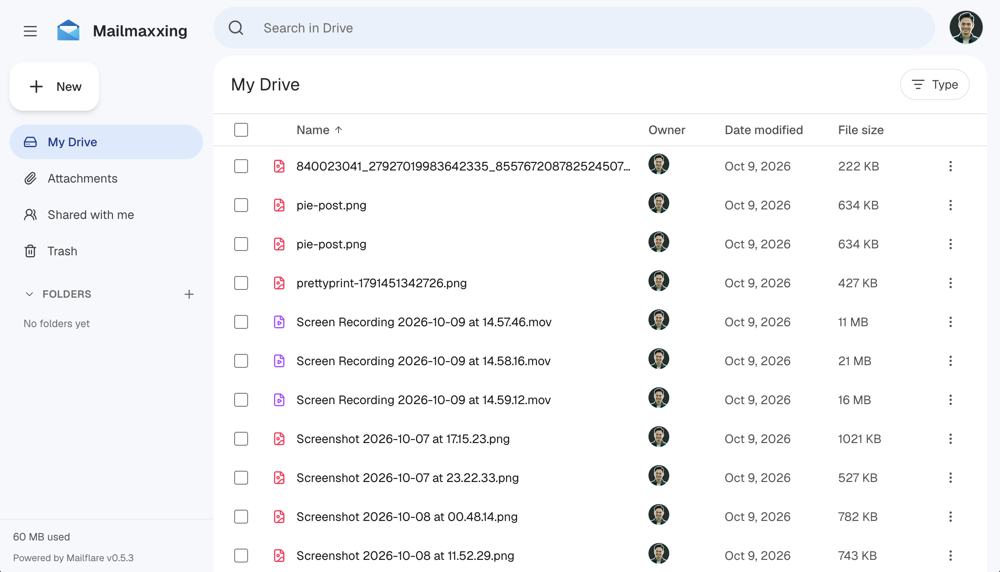

# Mailflare

A self-hosted alternative to Google Workspace. Setup **custom domain Emails**, **Calendar, Drive, Booking** and **built-in AI agents**.

Run it on Cloudflare or Docker. Send and receive with Cloudflare, Resend or Amazon SES. Store files in R2, Backblaze B2 or AWS S3. Use D1, Postgres, MySQL or Turso for the database.

[](https://deploy.workers.cloudflare.com/?url=https://github.com/hieunc229/mailflare)

## Screenshots

<table>
  <tr>
    <td align="center"><br>Inbox</td>
    <td align="center"><br>Domains</td>
    <td align="center"><br>Mailboxes</td>
  </tr>
  <tr>
    <td align="center"><br>Calendar</td>
    <td align="center"><br>Booking</td>
    <td align="center"><br>Drive</td>
  </tr>
</table>

### Sponsors

<a target="_blank" href="https://sequenzy.com/?ref=hieunc229/mailflare"></a>
&nbsp;
<a target="_blank" href="https://drivemug.com/?ref=hieunc229/mailflare"></a>

Want to support Mailflare? [Become a sponsor](https://store.paymug.co/buy/mailflare-sponsor).

## Features

### Apps

- **Email**: Custom domain mailboxes, personal or shared, with access you control. Send and receive with Cloudflare Email, Resend or Amazon SES.
- **Routing rules**: Store, forward, reject or sort incoming mail.
- **Calendar**: Repeating events with time zones. Attendees get email invitations.
- **Booking**: Share a public link so anyone can book a free time on your calendar.
- **Drive**: Store and share files.
- **AI agents**: Search mail, draft replies and manage events. Connect other AI tools over MCP.

### Technical

- **Databases**: Cloudflare D1 (default), PostgreSQL, MySQL, Turso / libSQL, or a local SQLite file. Set `DATABASE_URL` to switch. Works with Supabase, Neon, PlanetScale, TiDB and more. See [Databases](docs/databases.md).
- **File storage**: Cloudflare R2, Backblaze B2 or AWS S3.
- **Hosting**: Cloudflare Workers or a single Docker container.
- **Admin**: Users, API keys, webhooks, audit logs and backups.
- **Import**: Bring in mail from IMAP, Gmail Takeout, `.eml` and `.mbox` files.

Mailflare currently supports 34 languages, including English, Português (Brasil), Português (Portugal), Español, Français, Deutsch, Italiano, Nederlands, Polski, Українська, Русский, Türkçe, 中文（简体）, 日本語, 한국어, Bahasa Indonesia, Bahasa Melayu, Tiếng Việt, ไทย, हिन्दी, বাংলা, मराठी, తెలుగు, தமிழ், ગુજરાતી, ಕನ್ನಡ, മലയാളം, ਪੰਜਾਬੀ, සිංහල, Kiswahili, Hausa, plus العربية, اردو and فارسی (right-to-left).

## Cost

You can receive and send mail for free.

- **Receiving**: Cloudflare Email Routing is free.
- **Sending**: Use the free tier of Resend (3,000 emails a month) or Amazon SES. Cloudflare's own sending needs the $5/month Paid Worker plan.

New Amazon SES accounts start in a sandbox. Ask AWS for production access to lift it. Prices change, so check [Resend](https://resend.com/pricing), [Amazon SES](https://aws.amazon.com/ses/pricing/) and [Cloudflare](https://developers.cloudflare.com/workers/platform/pricing/).

## Deploy

1. **Deploy the app.** Click **Deploy to Cloudflare**. Keep the app name `mailflare`, or it will break.
2. **Finish setup.** Open the app at `/setup` and create your admin account.
3. **Connect a domain.** Add a domain from the same Cloudflare account, then create your first mailbox.

> **`CF_TOKEN` is required.** Create a scoped [Cloudflare API token](https://github.com/hieunc229/mailflare/issues/24#issuecomment-5523686105) with these permissions:
>
> - All accounts: Email Sending:Edit, DNS Settings:Edit, Email Routing Addresses:Edit
> - All zones: DNS Settings:Edit, Email Routing Rules:Edit, Zone Settings:Edit, DNS:Edit

More options: [deployment guide](docs/deployment.md).

### Deploy with an AI agent

Paste this into an AI agent that has terminal access (Claude Code, Codex, Cursor and similar):

```text
Install Mailflare for me from https://github.com/hieunc229/mailflare on my Cloudflare account.

1. Read README.md, docs/deployment.md and wrangler.jsonc first.
2. Ask me for my Cloudflare account ID and two API tokens, using a secret input:
   a deploy token (for Wrangler) and a runtime token (the Worker secret CF_TOKEN).
   Never print them, commit them, or pass them as command arguments.
3. Keep the Worker name exactly "mailflare". Create or reuse the D1 database
   "mailflare", the R2 bucket "mailflare-raw", and the queues "mailflare-inbound",
   "mailflare-outbound" and "mailflare-agent".
4. Install dependencies, run `npm run deploy`, and set CF_TOKEN as a Worker secret.
   Do not run remote database migrations yourself. The /setup page does that.
5. Give me the app URL and anything I still need to do. I will open /setup, create
   the admin account and connect my domain.
```

Token permissions and more options: [deployment guide](docs/deployment.md#deploy-with-an-ai-coding-agent).

### Self-host with Docker

Runs as one container on any server, with SQLite and local files.

```bash
cp .env.docker.example .env.docker
docker compose up -d --build
```

See [self-hosting](docs/self-hosting.md).

## Local development

```bash
cp .dev.vars.example .dev.vars
npm install
npm run db:migrate:local
npm run dev
```

Add your Cloudflare credentials to `.dev.vars`, then open [localhost:3000](http://localhost:3000). Run `npm run db:seed` to load sample data.

- `npm run build`: build the Worker
- `npm run deploy`: build and deploy
- `npm run lint`: lint and type check

A schema change needs a migration for each database type. See [Databases](docs/databases.md#migrations).

## Documentation

- [Deployment and configuration](docs/deployment.md)
- [Databases](docs/databases.md)
- [Sending and receiving providers](docs/providers.md)
- [API and integrations](docs/api.md)
- [Email assistant and MCP](docs/email-assistant-and-mcp.md)
- [Adding a language](docs/localization.md)
- [Troubleshooting](docs/troubleshooting.md)

## License

See [LICENSE](LICENSE).
